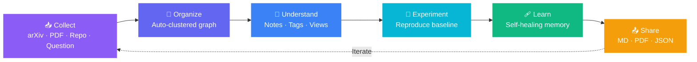
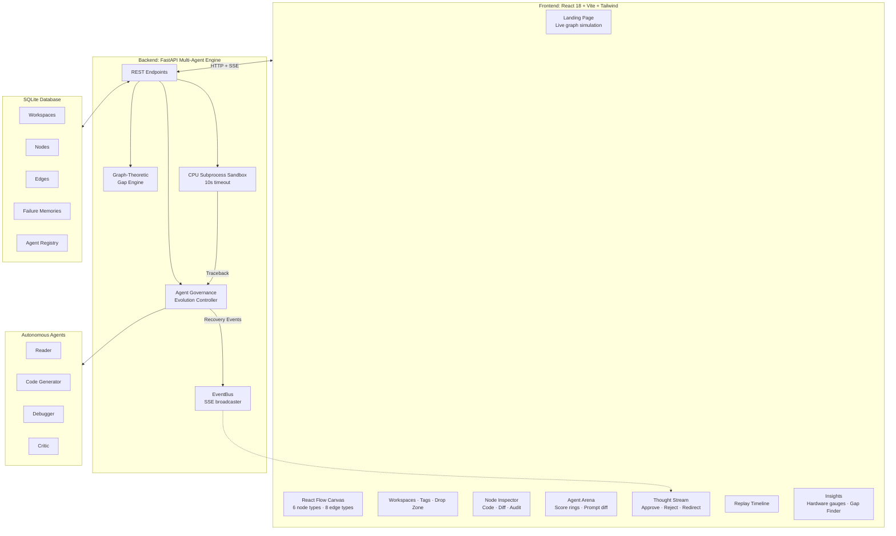
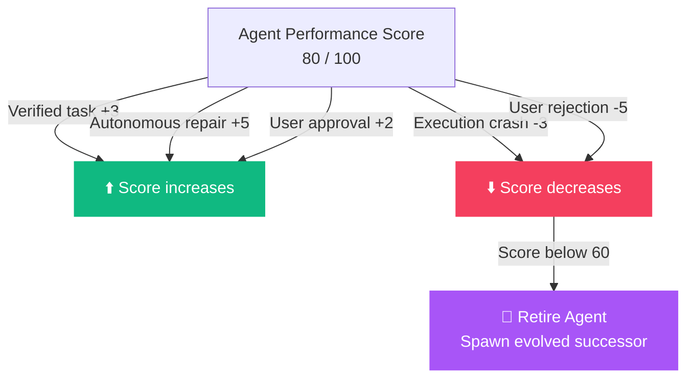

 <div align="center">


<a href="https://github.com/abhishek-s-gupta">

</a>

<br/>


<br/>


<br/>

**[🚀 Quick Start](#-quick-start) • [✨ Features](#-13-signature-features) • [🏛️ Architecture](#-system-architecture) • [🎬 Demo](#-3-minute-demo-script) • [📡 API](#-backend-rest--sse-endpoints)**

</div>

---

## 💡 The Problem We Solve

<table>
<tr>
<td width="50%" valign="top">

### 🗂️ The Organization Gap

Research papers, datasets, code repositories, and notes live in disconnected places.

Connections between ideas get lost, making it difficult to understand the complete research landscape.

</td>
<td width="50%" valign="top">

### ⚙️ The Execution Gap

Broken environments, missing dependencies, and non-reproducible baselines make experiment reproduction difficult.

Researchers spend more time debugging environments than exploring ideas.

</td>
</tr>
</table>

<div align="center">

### ⬇️ SynapseGraph closes both gaps ⬇️

**One visual canvas + A self-evolving, human-controllable team of AI agents**

</div>

---

## 🔁 The 6-Stage Research Loop



---

## 🏛️ System Architecture



**Communication:** REST APIs for operations and Server-Sent Events (SSE) for real-time agent updates.

---

## 🤖 Meet the Agents

| Agent | Responsibility | Initial Score |
|:---:|---|:---:|
| 🧠 **Controller** | Breaks goals into subtasks and coordinates specialists | Orchestrator |
| 📖 **Reader** | Extracts claims, datasets, and hyperparameters | 80/100 |
| 💻 **Code-Gen** | Converts methodologies into Python scripts | 80/100 |
| 🩹 **Debugger** | Analyzes tracebacks and proposes fixes | 80/100 |
| 🕵️ **Critic** | Evaluates results against paper baselines | 80/100 |

### 🧬 Agent Evolution & Reward System



---

## ✨ 13 Signature Features

<table>
<tr>
<td width="33%" valign="top">

### ⚡ 1. Auto Demo

A guided tour demonstrating the complete research workflow:

Ingest → Audit → Code → Crash → Heal → Verify → What-If → Export.

</td>
<td width="33%" valign="top">

### 💥 2. Break It

Inject a controlled experiment failure, capture the traceback, and let the Debugger attempt autonomous recovery.

</td>
<td width="33%" valign="top">

### 🎯 3. Reproducibility Gauge

Visual comparison of measured experiment results against reference paper baselines.

</td>
</tr>
<tr>
<td valign="top">

### 🌿 4. What-If Branching

Create experiment branches, modify hyperparameters, and compare outcomes.

</td>
<td valign="top">

### 🧠 5. Failure Memory

Store resolved error signatures and reuse previously successful recovery strategies.

</td>
<td valign="top">

### ⌘ 6. Command Palette

Use `Ctrl + K` to search nodes, trigger actions, and navigate the research workspace.

</td>
</tr>
<tr>
<td valign="top">

### 🛡️ 7. Resilient Mode

Offline-first workflows with deterministic fallback behavior when external services are unavailable.

</td>
<td valign="top">

### 🧬 8. Agent Evolution

Retire underperforming agents and introduce evolved successors based on performance scores.

</td>
<td valign="top">

### 👥 9. Presence

Collaborator avatars and shareable read-only workspace experiences.

</td>
</tr>
<tr>
<td valign="top">

### ⌨️ 10. Keyboard Shortcuts

Press `?` to access the keyboard shortcut guide.

</td>
<td valign="top">

### 📊 11. Live Telemetry

Monitor CPU usage, RAM, agent latency, and execution metrics.

</td>
<td valign="top">

### 🔍 12. Research Gap Finder

Identify isolated graph clusters and unresolved relationships to suggest research directions.

</td>
</tr>
<tr>
<td colspan="3" valign="top" align="center">

### 🎙️ 13. Voice Commands

Use voice input to trigger supported research actions such as reproducing experiments, finding gaps, and starting demos.

</td>
</tr>
</table>

---

## 🎨 Design System

### Node Color Palette

| Node | Color | Hex |
|:---:|---|:---:|
| 📄 **Paper** | Electric Violet | `#8B5CF6` |
| ❓ **Question** | Warm Amber | `#F59E0B` |
| 🗄️ **Dataset** | Emerald | `#10B981` |
| 💻 **Code** | Cyan | `#06B6D4` |
| 🔥 **Failure** | Rose | `#F43F5E` |
| 🏆 **Result** | Fuchsia | `#A855F7` |

### Visual Identity

- **Dark-first:** Near-black `#07080C` background.
- **Effects:** Glassmorphism cards and subtle glowing borders.
- **Gradients:** Violet → Cyan.
- **Typography:** Inter and JetBrains Mono.
- **Motion:** Smooth transitions, spring animations, and staggered reveals.

### Eight Graph Relationships

`cites` · `supports` · `contradicts` · `answers` · `generates_code` · `failed_with` · `patched_to` · `what_if_branch`

---

## 🎬 See It In Action

<div align="center">

<!-- Add your actual GIF and screenshots inside docs/assets/ -->


<br/><br/>

| Research Canvas | Self-Healing | Agent Arena |
|:---:|:---:|:---:|
|  |  |  |

</div>

---

## 🚀 Quick Start

**Requirements**

- Python 3.11+
- Node.js 18+
- npm
- No GPU required for the CPU-based workflows.

### 1. Clone Repository

```bash
git clone https://github.com/abhishek-s-gupta/synapsegraph.git

cd synapsegraph
```

### 2. Windows

If the repository includes the startup script:

```powershell
.\start.ps1
```

### 3. Manual Setup

**Terminal 1 — Backend**

```bash
cd backend

python -m venv .venv
```

Windows:

```powershell
.venv\Scripts\activate
```

Linux/macOS:

```bash
source .venv/bin/activate
```

Install dependencies:

```bash
pip install -r requirements.txt
```

Start the backend using the entry point configured in your project. For example:

```bash
uvicorn main:app --host 127.0.0.1 --port 8000
```

**Terminal 2 — Frontend**

```bash
cd frontend

npm install

npm run dev
```

### Application URLs

| Service | URL |
|---|---|
| 🎨 Frontend | http://localhost:5173 |
| ⚙️ Backend | http://localhost:8000 |
| 📚 API Documentation | http://localhost:8000/docs |

---

## 🧪 3-Minute Demo Script

<details open>
<summary><b>⏱️ 0:00 – 0:30 | Landing Page</b></summary>

- Show the animated hero graph.
- Introduce the research intelligence concept.
- Launch the workspace.

</details>

<details>
<summary><b>🗺️ 0:30 – 1:00 | Research Canvas</b></summary>

- Open the Research Canvas.
- Select a Paper node.
- Demonstrate graph relationships.
- Switch between Graph, Cluster, List, and Grid views if available.

</details>

<details>
<summary><b>💥 1:00 – 1:40 | Self-Healing</b></summary>

1. Trigger the controlled failure demonstration.
2. Show the sandbox execution error.
3. Open the captured traceback.
4. Demonstrate the Debugger's recovery attempt.
5. Show the verification result.

</details>

<details>
<summary><b>🧬 1:40 – 2:10 | Agent Evolution</b></summary>

- Open the Agent Arena.
- Demonstrate reward scoring.
- Show the agent retirement and successor workflow, if enabled.

</details>

<details>
<summary><b>🔍 2:10 – 2:40 | Research Gaps & What-If</b></summary>

- Open the Insights panel.
- Run research gap analysis.
- Create a hypothesis.
- Fork an experiment and modify its parameters.

</details>

<details>
<summary><b>🎙️ 2:40 – 3:00 | Voice & Export</b></summary>

- Demonstrate a supported voice command.
- Export the research workspace.
- Finish with the complete connected knowledge graph.

</details>

---

## 📡 Backend REST & SSE Endpoints

| Method | Endpoint | Description |
|:---:|---|---|
| GET | `/api/health` | Hardware telemetry and service status |
| GET | `/api/workspaces` | List research workspaces |
| POST | `/api/workspaces` | Create workspace |
| GET | `/api/workspaces/{id}` | Retrieve complete graph |
| POST | `/api/workspaces/{id}/ingest` | Import research material |
| POST | `/api/workspaces/{id}/reproduce` | Start experiment reproduction |
| POST | `/api/workspaces/{id}/break-it` | Controlled failure demonstration |
| POST | `/api/workspaces/{id}/what-if` | Fork experiment results |
| GET | `/api/workspaces/{id}/gaps` | Research gap analysis |
| POST | `/api/workspaces/{id}/hypothesis` | Create hypothesis node |
| GET | `/api/workspaces/{id}/export` | Export workspace |
| GET | `/api/workspaces/{id}/stream` | Real-time thought stream |
| GET | `/api/metrics/stream` | Live system metrics |
| POST | `/api/agents/{id}/control` | Approve, pause, reject, redirect |
| POST | `/api/agents/{id}/evolve` | Agent evolution |
| POST | `/api/voice/intent` | Process voice intent |

> Check your actual FastAPI routes before publishing this endpoint list.

---

## 🧾 Core Graph Schema

<details>
<summary><b>Click to expand JSON example</b></summary>

```json
{
  "workspace_id": "ws_01",
  "title": "Edge Anomaly Detection Study",
  "nodes": [
    {
      "id": "node_101",
      "type": "paper",
      "title": "Research Paper",
      "content": "Research methodology",
      "metadata": {
        "tags": ["TinyML"],
        "metrics": {
          "f1": 0.88
        }
      },
      "position": {
        "x": 120,
        "y": 240
      },
      "created_at": "2026-11-13T10:00:00Z"
    }
  ],
  "edges": [
    {
      "id": "edge_1",
      "source": "node_101",
      "target": "node_102",
      "relation": "supports"
    }
  ],
  "agent_registry": [
    {
      "id": "debugger",
      "reward_score": 92,
      "runs": 14,
      "status": "active"
    }
  ]
}
```

</details>

---

## 🔒 Sandbox Safety

The execution sandbox is designed with the following safeguards:

- ⏱️ Configurable subprocess execution timeout.
- 📁 Temporary workspace for experiment files.
- 🔁 Limited debugging retry attempts.
- 🧯 stdout, stderr, and traceback capture.
- 🛡️ Controlled execution environment.

**Note:** A subprocess sandbox and temporary directory alone do not provide strong security isolation against malicious code. Do not run untrusted research scripts without additional operating-system-level restrictions.

---

## 💻 Hardware Requirements

| Component | Requirement |
|---|---|
| Processor | Modern Intel / AMD / Apple Silicon CPU |
| Memory | 4 GB RAM minimum (project-dependent) |
| GPU | Not required for CPU-based workflows |
| Storage | Depends on imported papers and datasets |

---

## 🛠️ Tech Stack

<div align="center">


</div>

---

## 🏆 Hackathon

<div align="center">

**NavUtkarsh x Leo Hackathon 2026**

**Problem Statement 03 — ResearchGraph**

Built to make scientific research more connected, reproducible, and accessible.

</div>

---

## 👨‍💻 Built By

<div align="center">

### [Abhishek Gupta](https://github.com/abhishek-s-gupta)(https://www.linkedin.com/in/abhishek-s-gupta)

*Built with ❤️ for modern autonomous scientific research.*

⭐ **If SynapseGraph impressed you, give the repository a star!** ⭐


</div>
