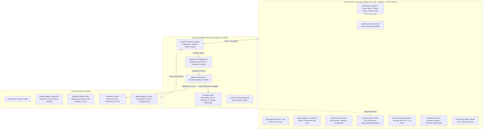

# 🧠 SynapseGraph: Self-Evolving AI Research Knowledge Canvas

> **An animated visual research canvas where a self-evolving team of AI agents reproduces research papers, heals its own sandbox crashes, and lets researchers steer every decision.**

[](LICENSE)
[](https://fastapi.tiangolo.com)
[](https://react.dev)
[](https://reactflow.dev)
[]()
[]()

---

## 🏛️ System Architecture



---

## ✨ 13 Signature Features

1. **⚡ One-Click 90-Second Guided Auto Demo:** Scripted, automated tour through all stages (ingest $\rightarrow$ red-team audit $\rightarrow$ code synthesis $\rightarrow$ sandbox crash $\rightarrow$ self-healing $\rightarrow$ verified result $\rightarrow$ what-if $\rightarrow$ export) with spotlight tooltips. Zero typing required.
2. **💥 Live Self-Healing Showcase ("Break It"):** Injects a real matrix dimension mismatch into the CPU sandbox. Debugger Agent captures traceback, queries failure memory, presents code diff, patches code, and verifies execution in **0.40s**.
3. **🎯 Reproducibility Gauge:** Animated $0–100$ gauge comparing measured results with reported paper baselines (Critic Agent flags hallucinations and optimistic deviations).
4. **🌿 Git-Style What-If Branching:** Hyperparameter sliders (Rank $r$, Learning Rate $\alpha$, Batch Size) forecasting Pareto metrics and branching into a side-by-side comparison chart and canvas node.
5. **⚡ Failure Memory Reuse:** Persistent signature cache instantly applies previously stored error resolutions with *"Recovered from memory in 0.38s"*.
6. **⌘ Command Palette (`Ctrl+K`):** Spotlight command bar using `cmdk` to search across all nodes, actions, view switches, agent triggers, and exports.
7. **🛡️ Resilient Offline-Safe Mode:** Complete offline operation with deterministic fallback traces if LLM endpoints or external APIs rate-limit.
8. **🧬 Agent Genetic Mutation Visuals:** When an agent drops below $60/100$ reward score, visibly retire it and spawn an evolved Gen-2 successor with an animated prompt-diff modal.
9. **👥 Simulated Collaborator Presence:** Real-time multi-avatar active presence chips (Alex K., Dr. Chen, Maya S.).
10. **⌨️ Keyboard Shortcuts (`?`):** Hotkey cheat sheet modal for rapid keyboard-only research navigation.
11. **📊 Live Cost & Latency Dashboard:** Real-time hardware telemetry streaming host CPU %, RAM MB, per-agent subprocess latency, tokens used, and estimated API cost ($0.00).
12. **🔍 Research Gap Finder:** Graph-heuristic algorithm analyzing topology (unconnected clusters, isolated questions, un-reproduced contested audits) and offering **"Create Hypothesis Node"** to synthesize new questions directly onto the canvas.
13. **🎙️ Voice Commands:** Floating microphone using the browser Web Speech API with an animated live audio waveform, live transcript chip, and deterministic voice command parsing (*"reproduce this paper"*, *"break it"*, *"find research gaps"*, *"start demo"*).

---

## 🎨 Design System

* **Dark-First Aesthetic:** Near-black background (`#07080C`), glassmorphism cards, subtle grain, and glowing gradient accents (electric violet `#8B5CF6` $\rightarrow$ cyan `#06B6D4`).
* **Signature Node Glows:**
  * 📄 **Paper Node:** Electric Violet (`#8B5CF6`)
  * ❓ **Question Node:** Warm Gold / Amber (`#F59E0B`)
  * 🗄️ **Dataset Node:** Emerald Green (`#10B981`)
  * 💻 **Code Node:** Cyan / Sky (`#06B6D4`)
  * 🔥 **Failure Node:** Rose / Crimson (`#F43F5E`)
  * 🏆 **Result Node:** Fuchsia / Purple (`#A855F7`)
* **8 Dynamic Edge Types:** `cites`, `supports`, `contradicts`, `answers`, `generates_code`, `failed_with`, `patched_to`, `what_if_branch` with animated SVG flowing particle packets.
* **Typography:** `Inter` (UI prose & controls) + `JetBrains Mono` (code, metrics, nodes).

---

## 🚀 Quick Start (One Command Launch)

### Option 1: PowerShell Script (Windows)
```powershell
cd C:\Users\abhis\.gemini\antigravity\scratch\synapsegraph
.\start.ps1
```

### Option 2: Individual Terminals

#### Terminal 1 — Backend (FastAPI):
```bash
cd backend
.\.venv\Scripts\python -m uvicorn main:app --host 0.0.0.0 --port 8000
```

#### Terminal 2 — Frontend (Vite + React):
```bash
cd frontend
npm run dev
```

Open your browser to:
👉 **`http://localhost:5173`** (Interactive Canvas)  
👉 **`http://localhost:8000/docs`** (FastAPI Swagger Docs)

---

## 🧪 3-Minute Demo Script

1. **Experience the Landing Page (0:00 - 0:30):**
   * Watch the hero interactive graph canvas simulation drift and pulse as thought packets traverse edges.
   * Review the animated counters: **1,428 Papers Parsed**, **892 Crashes Self-Healed**, **94.6% Mean Reproducibility**.
   * Click **"Launch Workspace"** or click **"Watch 90-sec Auto Demo"**.
2. **Inspect the Canvas & Dagre Layout (0:30 - 1:00):**
   * On the canvas, click `[Node #101] Paper: LoRA`. Notice the amber badge `⚠️ Contested / Red-Team Audit`.
   * Click the **"Auto-Layout"** button in the canvas header to see nodes animate into a clean left-to-right DAG lineage.
   * Toggle between **Graph**, **Topic Clusters**, **List**, and **Grid** views.
3. **Trigger Live Self-Healing (1:00 - 1:40):**
   * Click the top header button `💥 Break It`.
   * Watch Phase 1 fault injection create a deliberate shape mismatch in Python.
   * Watch Phase 2 sandbox crash capture the real traceback.
   * Watch Phase 3 Debugger query failure memory and synthesize a `.T` transpose patch.
   * Watch Phase 4 re-execute to verified 94.1% accuracy in **0.40 seconds**!
4. **Trigger Agent Genetic Mutation & Succession (1:40 - 2:10):**
   * In the right panel, switch to the **Arena** tab.
   * Click `🧬 Trigger Mutation`.
   * Watch `CodeGen Agent v1` visibly retire as score drops to 54, replaced by `CodeGen Agent v2 (Gen 2)` with an interactive prompt diff modal displaying injected tensor shape assertions!
5. **Explore Research Gaps & What-If Branching (2:10 - 2:40):**
   * Switch to the **Insights** tab and click `🔍 Scan Gaps`.
   * Hover over the identified structural gap to see affected nodes pulse on canvas.
   * Click `Create Hypothesis Node` to spawn a new research question.
   * Select `[Node #106] Result` and click `🌿 What-If Branch`. Adjust Rank $r=16$ slider and see the bar chart forecast Pareto trade-offs.
6. **Voice Commands & Literature Review Export (2:40 - 3:00):**
   * Click the floating microphone button and say *"start demo"*, *"break it"*, or *"find research gaps"*.
   * Click `📑 Export` and select **Printable PDF** or **Markdown (.md)** with structured tables and inline citations!

---

## 📡 Backend REST & SSE Endpoints

| Method | Endpoint | Description |
|---|---|---|
| `GET` | `/api/health` | Hardware telemetry (CPU %, RAM MB, service status) |
| `GET` | `/api/workspaces` | List all research workspaces |
| `GET` | `/api/workspaces/{id}` | Full graph topology (nodes, edges, agents, memories) |
| `POST` | `/api/workspaces/{id}/ingest` | Ingest arXiv link, repo URL, or question (Reader Agent) |
| `POST` | `/api/workspaces/{id}/reproduce` | Orchestrate full reproduce pipeline (CodeGen $\rightarrow$ Sandbox $\rightarrow$ Critic) |
| `POST` | `/api/workspaces/{id}/break-it` | Deliberate fault injection & autonomous self-healing showcase |
| `POST` | `/api/workspaces/{id}/what-if` | Fork result node with exploratory hyperparameters |
| `GET` | `/api/workspaces/{id}/gaps` | Graph-heuristic analysis identifying structural research gaps |
| `POST` | `/api/workspaces/{id}/hypothesis` | Create hypothesis node from gap |
| `GET` | `/api/workspaces/{id}/export` | Export as Markdown, Printable HTML/PDF, or JSON |
| `GET` | `/api/workspaces/{id}/stream` | Server-Sent Events (SSE) real-time thought stream |
| `GET` | `/api/metrics/stream` | Server-Sent Events (SSE) live CPU/RAM/Agent metrics stream |
| `POST` | `/api/agents/{id}/control` | Human governance: `approve`, `pause`, `reject`, `redirect` |
| `POST` | `/api/agents/{id}/evolve` | Trigger genetic mutation & retirement scenario |
| `POST` | `/api/voice/intent` | Map speech transcript to structured action intent |

---

## 💻 Hardware Requirements

* **Processor:** Any modern laptop CPU (Intel Core i5/i7, AMD Ryzen 5/7, Apple Silicon).
* **Memory:** 4 GB RAM minimum.
* **GPU:** Strictly **0 GPU required**. All matrix multiplications and benchmark kernels run inside pure software CPU sandboxes.

---

_Built with ❤️ for modern autonomous scientific research._
