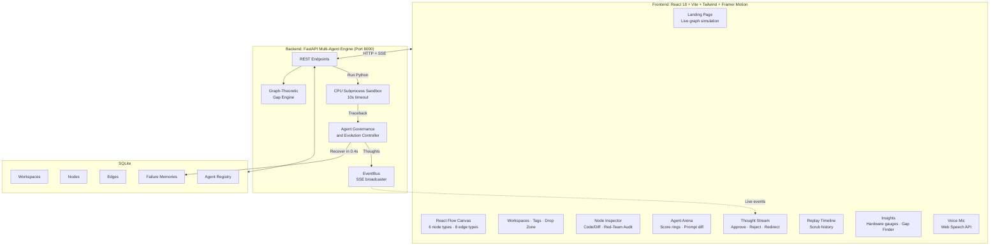
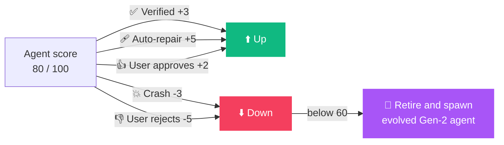

<div align="center">


<a href="https://github.com/abhishek-s-gupta">
  
</a>

<br/>


<br/>

**[Quick Start](#-quick-start)** &nbsp;•&nbsp; **[Features](#-13-signature-features)** &nbsp;•&nbsp; **[Architecture](#-system-architecture)** &nbsp;•&nbsp; **[Demo Script](#-3-minute-demo-script)** &nbsp;•&nbsp; **[API](#-backend-rest--sse-endpoints)**

</div>

---

## 🎬 See It In Action

<div align="center">

<!-- Add your recorded demo GIF at docs/assets/demo.gif -->


<br/><br/>

| Canvas | Self-Healing | Agent Arena |
|:---:|:---:|:---:|
|  |  |  |

</div>

---

## 💡 The Problem We Solve

<table>
<tr>
<td width="50%" valign="top">

### 🗂️ The Organization Gap
Papers, datasets, code repos and browser tabs live in a dozen disconnected places. Connections between ideas get lost, and nobody can see the whole picture.

</td>
<td width="50%" valign="top">

### ⚙️ The Execution Gap
Broken environments, missing dependencies and non-reproducible baselines turn "just run the paper" into days of debugging.

</td>
</tr>
</table>

<div align="center">

### ⬇️ &nbsp; SynapseGraph closes both gaps &nbsp; ⬇️

**One visual canvas** &nbsp;+&nbsp; **a self-evolving, human-controllable team of AI agents**

</div>

---

## 🔁 The 6-Stage Research Loop


---

## 🏛️ System Architecture



---

## 🤖 Meet the Agents

<div align="center">

| Agent | Role | Reward Rules |
|:---:|:---|:---|
| 🧠 **Controller** | Breaks goals into a DAG of subtasks and dispatches specialists | Orchestrator |
| 📖 **Reader** | Extracts claims, datasets and hyperparameters from raw text | Starts at **80 / 100** |
| 💻 **Code-Gen** | Turns methodology into clean, lightweight Python | Starts at **80 / 100** |
| 🩹 **Debugger** | Reads tracebacks and generates deterministic fixes | Starts at **80 / 100** |
| 🕵️ **Critic** | Validates results against paper baselines, flags hallucinations | Starts at **80 / 100** |

</div>



---

## ✨ 13 Signature Features

<table>
<tr>
<td width="33%" valign="top">

### ⚡ 1. Auto Demo
Scripted 90-second guided tour: ingest → audit → code → crash → heal → verify → what-if → export. Spotlight tooltips, zero typing.

</td>
<td width="33%" valign="top">

### 💥 2. Break It
Injects a real matrix shape mismatch into the sandbox. The Debugger reads the traceback, patches the code and verifies in **0.40s**.

</td>
<td width="33%" valign="top">

### 🎯 3. Reproducibility Gauge
Animated 0–100 gauge comparing measured results with paper baselines. The Critic flags hallucinations and optimistic deviations.

</td>
</tr>
<tr>
<td valign="top">

### 🌿 4. What-If Branching
Git-style forks. Tune Rank r, Learning Rate and Batch Size, then compare branches side by side on the canvas.

</td>
<td valign="top">

### 🧠 5. Failure Memory
Every fixed error signature is stored. Repeat errors recover instantly: *"Recovered from memory in 0.38s"*.

</td>
<td valign="top">

### ⌘ 6. Command Palette
`Ctrl+K` spotlight bar (cmdk) to search nodes, run actions, switch views and trigger agents.

</td>
</tr>
<tr>
<td valign="top">

### 🛡️ 7. Resilient Mode
Full offline operation. If LLM APIs rate-limit, deterministic cached traces keep everything running.

</td>
<td valign="top">

### 🧬 8. Agent Evolution
Agents under 60/100 are retired and replaced by a Gen-2 successor, with an animated prompt-diff modal.

</td>
<td valign="top">

### 👥 9. Presence
Simulated live collaborator avatars and shareable read-only workspace links.

</td>
</tr>
<tr>
<td valign="top">

### ⌨️ 10. Shortcuts
Press `?` for the full keyboard cheat sheet and navigate research without touching the mouse.

</td>
<td valign="top">

### 📊 11. Live Telemetry
Real-time CPU %, RAM, per-agent latency, tokens and cost ($0.00 in offline mode), streamed over SSE.

</td>
<td valign="top">

### 🔍 12. Gap Finder
Graph-theory heuristics find isolated clusters and unresolved contradictions, then spawn hypothesis nodes in one click.

</td>
</tr>
<tr>
<td colspan="3" align="center" valign="top">

### 🎙️ 13. Voice Commands
Floating mic with live waveform and transcript chip. Say *"reproduce this paper"*, *"break it"*, *"find research gaps"* or *"start demo"*.

</td>
</tr>
</table>

---

## 🎨 Design System

<div align="center">

| Node | Glow | Hex |
|:---:|:---:|:---:|
| 📄 **Paper** |  Electric Violet | `#8B5CF6` |
| ❓ **Question** |  Warm Amber | `#F59E0B` |
| 🗄️ **Dataset** |  Emerald | `#10B981` |
| 💻 **Code** |  Cyan | `#06B6D4` |
| 🔥 **Failure** |  Rose | `#F43F5E` |
| 🏆 **Result** |  Fuchsia | `#A855F7` |

</div>

- **Dark-first:** near-black `#07080C` background, glassmorphism cards, subtle grain, violet → cyan gradients
- **8 edge types:** `cites` · `supports` · `contradicts` · `answers` · `generates_code` · `failed_with` · `patched_to` · `what_if_branch`, each with animated flowing particles
- **Typography:** `Inter` for UI, `JetBrains Mono` for code, logs and metrics
- **Motion:** spring physics, 200–400ms, staggered reveals, `prefers-reduced-motion` respected

---

## 🚀 Quick Start

> **Requirements:** Python 3.10+, Node.js 18+. No GPU needed.

```bash
git clone https://github.com/abhishek-s-gupta/synapsegraph.git
cd synapsegraph
```

<details open>
<summary><b>🪟 Windows (one command)</b></summary>

```powershell
.\start.ps1
```

</details>

<details>
<summary><b>🐧 macOS / Linux / manual (two terminals)</b></summary>

**Terminal 1: Backend**
```bash
cd backend
python -m venv .venv && source .venv/bin/activate
pip install -r requirements.txt
uvicorn main:app --host 0.0.0.0 --port 8000
```

**Terminal 2: Frontend**
```bash
cd frontend
npm install
npm run dev
```

</details>

| Service | URL |
|:---|:---|
| 🎨 App | **http://localhost:5173** |
| 📚 API Docs (Swagger) | **http://localhost:8000/docs** |

---

## 🧪 3-Minute Demo Script

<details open>
<summary><b>⏱️ 0:00 – 0:30 &nbsp; Landing page</b></summary>

- Watch the hero graph drift and pulse as thought packets travel along edges
- Animated counters: **1,428 papers parsed**, **892 crashes self-healed**, **94.6% mean reproducibility**
- Click **Launch Workspace** or **Watch 90-sec Auto Demo**

</details>

<details>
<summary><b>🗺️ 0:30 – 1:00 &nbsp; Canvas and layout</b></summary>

- Click the `LoRA` paper node and notice the amber **Contested / Red-Team Audit** badge
- Hit **Auto-Layout** and watch nodes glide into a clean left-to-right DAG
- Toggle **Graph**, **Topic Clusters**, **List** and **Grid** views

</details>

<details>
<summary><b>💥 1:00 – 1:40 &nbsp; Live self-healing</b></summary>

1. Click **Break It** in the header
2. Phase 1: a deliberate shape mismatch is injected
3. Phase 2: the sandbox crashes and captures the real traceback
4. Phase 3: the Debugger queries failure memory and writes a `.T` transpose patch
5. Phase 4: re-run verifies **94.1% accuracy in 0.40 seconds**

</details>

<details>
<summary><b>🧬 1:40 – 2:10 &nbsp; Agent evolution</b></summary>

- Open the **Arena** tab and click **Trigger Mutation**
- `CodeGen v1` retires as its score drops to 54
- `CodeGen v2 (Gen 2)` takes over, with a prompt diff showing the new tensor-shape assertions

</details>

<details>
<summary><b>🔍 2:10 – 2:40 &nbsp; Gaps and What-If</b></summary>

- **Insights** tab → **Scan Gaps**, then hover a gap to pulse its nodes on the canvas
- **Create Hypothesis Node** spawns a new question instantly
- Select the Result node → **What-If Branch** → drag the Rank r slider and read the Pareto forecast chart

</details>

<details>
<summary><b>🎙️ 2:40 – 3:00 &nbsp; Voice and export</b></summary>

- Tap the mic and say *"start demo"*, *"break it"* or *"find research gaps"*
- **Export** as printable PDF, Markdown with structured tables and citations, or JSON

</details>

---

## 📡 Backend REST & SSE Endpoints

| Method | Endpoint | Description |
|:---:|:---|:---|
|  | `/api/health` | Hardware telemetry (CPU %, RAM MB, service status) |
|  | `/api/workspaces` | List all research workspaces |
|  | `/api/workspaces/{id}` | Full graph (nodes, edges, agents, memories) |
|  | `/api/workspaces/{id}/ingest` | Ingest arXiv link, repo URL or question (Reader Agent) |
|  | `/api/workspaces/{id}/reproduce` | Full pipeline: Code-Gen → Sandbox → Critic |
|  | `/api/workspaces/{id}/break-it` | Fault injection and autonomous self-healing |
|  | `/api/workspaces/{id}/what-if` | Fork a result node with new hyperparameters |
|  | `/api/workspaces/{id}/gaps` | Graph-heuristic research gap analysis |
|  | `/api/workspaces/{id}/hypothesis` | Create a hypothesis node from a gap |
|  | `/api/workspaces/{id}/export` | Export as Markdown, printable HTML/PDF or JSON |
|  | `/api/workspaces/{id}/stream` | Real-time thought stream |
|  | `/api/metrics/stream` | Live CPU / RAM / agent metrics |
|  | `/api/agents/{id}/control` | Governance: `approve` · `pause` · `reject` · `redirect` |
|  | `/api/agents/{id}/evolve` | Trigger genetic mutation and retirement |
|  | `/api/voice/intent` | Map a speech transcript to a structured action |

---

## 🧾 Core Graph Schema

<details>
<summary><b>Click to expand JSON schema</b></summary>

```json
{
  "workspace_id": "ws_01",
  "title": "Edge Anomaly Detection Study",
  "nodes": [
    {
      "id": "node_101",
      "type": "paper | question | dataset | code | failure | result",
      "title": "String",
      "content": "Markdown or Code String",
      "metadata": { "tags": ["TinyML"], "metrics": { "f1": 0.88 } },
      "position": { "x": 120, "y": 240 },
      "created_at": "ISO-8601"
    }
  ],
  "edges": [
    { "id": "edge_1", "source": "node_101", "target": "node_102", "relation": "answers" }
  ],
  "agent_registry": [
    { "id": "debugger", "reward_score": 92, "runs": 14, "status": "active" }
  ]
}
```

</details>

---

## 🔒 Sandbox Safety

- ⏱️ Subprocess **hard timeout of 10 seconds**
- 📁 File writes restricted to a temporary `/tmp/synapse_sandbox` directory
- 🔁 Debugger retry loop capped at **3 attempts**
- 🧯 Full stdout / stderr / traceback capture for every run

---

## 💻 Hardware Requirements

| Component | Requirement |
|:---|:---|
| **Processor** | Any modern laptop CPU (Intel i5/i7, AMD Ryzen 5/7, Apple Silicon) |
| **Memory** | 4 GB RAM minimum |
| **GPU** | **None.** All kernels run inside pure-CPU software sandboxes |

---

## 🛠️ Tech Stack

<div align="center">


</div>

---

<div align="center">

### Built by [Abhishek Gupta](https://github.com/abhishek-s-gupta)(https://www.linkedin.com/in/abhishek-s-gupta/)

*Built with ❤️ for modern autonomous scientific research.*

⭐ **If SynapseGraph impressed you, drop a star!** ⭐


</div># synapsegraph

